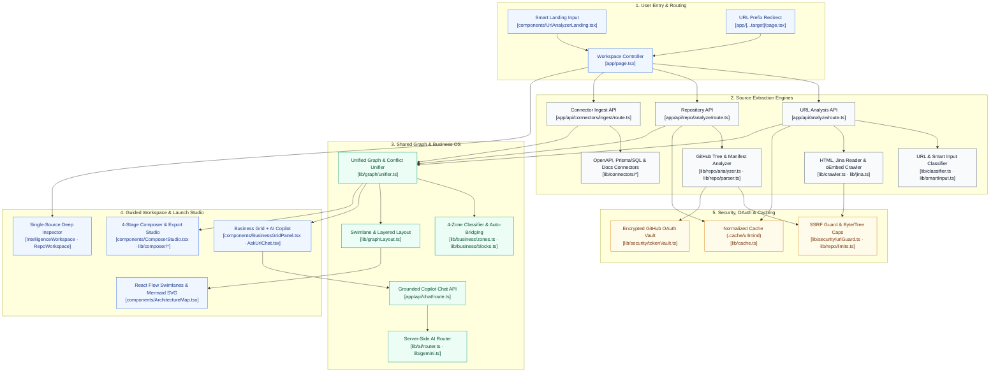

# SLASH — Unified Intelligence & Scrap-to-Business OS

[](./LICENSE)

**SLASH (Repo Unifier)** turns fragmented websites, unfinished AI prototypes, GitHub repositories, OpenAPI specs, database schemas, and documentation into one connected **4-Zone Business Architecture** and a run-ready application bundle.

It unites two core intelligence engines—**URLMIND** (Web & URL Intelligence) and **Repo Intelligence** (Source Code & Manifest Analysis)—through a shared graph engine, Auto-Bridging Business OS grid, human-approved **SLASH AI Copilot**, and **4-Stage Launch Studio**.

---

## 3-Step Guided Flow

1. **1. Connect (`/` or `/<any-url>`)**
   - Paste any public website URL, GitHub shorthand (`vercel/ai`), API spec, YouTube/social URL, or import Wappalyzer/BuiltWith CSV stacks.
   - Automatically routes straight into Step 2 (**Build & Fix**), or prepend your SLASH domain before any public URL (e.g. `https://your-domain.com/github.com/vercel/ai`).
2. **2. Build & Fix (Business OS Grid + Swimlane Map + AI Copilot)**
   - **4-Zone Business Grid**: Organizes connected sources into `01 Frontend`, `02 Brain / AI`, `03 Data`, and `04 Auth & Payments`.
   - **Auto-Bridging Gap Detector**: Flags missing login, billing, shared vector memory, or workflow automation and lets you snap in **Verified Business Blocks** (`Clerk`, `Supabase`, `Stripe`, `Razorpay`, `pgvector`, `n8n`) in one click.
   - **Business Zone Swimlanes (`Architecture Map`)**: Interactive React Flow canvas grouped across 4 horizontal swimlanes with `+ Add` gap slots, a single consolidated `Filter` popover, and a `Code / Mermaid` view with `.mmd` / `.svg` / `.png` export.
   - **Human-Approved SLASH AI Copilot**: Grounded Q&A over observed graph evidence with explicit approval gates before adding edges or blocks.
3. **3. Launch (App Composer & Export Studio)**
   - **Stage 1 & 2**: Compatibility, auth scheme, and SPDX license conflict detection with explicit human approval (`Approve Plan & Generate Project`).
   - **Stage 3 & 4**: Generates API Gateway routes (`src/gateway/routes.json`, `src/app/api/gateway/[...slug]/route.ts`), `.env.bridge.example`, `docker-compose.yml`, an isolated `<iframe sandbox="allow-scripts">` preview, and downloadable `.zip` export.

---

## System Architecture



---

## Local Development

```bash
npm install
cp .env.example .env.local
# Add GEMINI_API_KEY (and optional integrations) in .env.local
npm run dev
```

Open [http://localhost:3000](http://localhost:3000).

Run the unit test suite and linter:

```bash
npx --yes tsx --test lib/urlmind.test.ts
npm run lint
npm run build
```

---

## Self-Hosting with Docker

Run the full self-hosted stack (`Next.js` app + `PostgreSQL 17 / pgvector / Apache AGE` + `Valkey`) via Docker Compose:

```bash
docker compose up -d
```

To also run the optional offline local LLM profile (`Ollama`):

```bash
docker compose --profile local-llm up -d
```

Or build the standalone container image:

```bash
docker build -t slash-app .
docker run -p 3000:3000 \
  -e GEMINI_API_KEY=your_gemini_api_key \
  -e CACHE_TTL_HOURS=24 \
  slash-app
```

---

## Environment Variables (Server-Only)

All credentials stay strictly server-side via environment variables and `/api/*` routes—never entered in browser UI or exposed in `NEXT_PUBLIC_*` variables.

| Variable | Required | Default | Purpose |
| --- | --- | --- | --- |
| `GEMINI_API_KEY` | Yes (for AI) | — | Google Gemini API key used by server-side `/api/*` routes. |
| `APP_URL` | Recommended | `http://localhost:3000` | Public base URL for self-referential links and GitHub OAuth callbacks. |
| `GITHUB_TOKEN` | No | — | Optional GitHub PAT raising REST API rate limits for public Repo Intelligence scans. |
| `GITHUB_OAUTH_CLIENT_ID` | No | — | Enables read-only popup GitHub OAuth login for user-owned public/private repos. |
| `GITHUB_OAUTH_CLIENT_SECRET` | No | — | Server-only GitHub OAuth App secret used for code exchange. |
| `OAUTH_SESSION_SECRET` | No | Ephemeral dev key | 32+ char key for AES-256-GCM encrypted `HttpOnly` GitHub session cookies & HMAC state. |
| `META_OEMBED_TOKEN` | No | — | Meta App Access Token (`AppID\|AppSecret`) for Instagram Graph oEmbed previews. |
| `JINA_API_KEY` | No | — | Optional Jina Reader Bearer token raising rate limits for `r.jina.ai` markdown fallback. |
| `AI_PROVIDER` | No | `auto` | Server AI routing strategy (`auto` \| `gemini` \| `ollama` \| `deterministic`). |
| `OLLAMA_BASE_URL` | No | — | Local Ollama server endpoint (e.g. `http://ollama:11434`) for offline self-hosted AI. |
| `OLLAMA_MODEL` | No | `llama3.1:8b` | Default local Ollama model tag. |
| `OPENAI_API_KEY` | No | — | Optional server-side BYOK OpenAI credential. |
| `ANTHROPIC_API_KEY` | No | — | Optional server-side BYOK Anthropic credential. |
| `CACHE_TTL_HOURS` | No | `24` | Shared memory + `.cache/urlmind/` disk LRU cache retention in hours. |
| `URLMIND_CAMPAIGN_*` | No | — | Redirect destinations for `/out/[campaign]` (`COFFEE`, `AGENTS`, `SUPERINTELLIGENCE`, `STUDY`, `SPONSOR`). |

---

## License

MIT © 2026 [1nsharma](./LICENSE)


---

## 💼 Sponsorship, Support & Founder

Maintained by **Amit Sharma (@1nsharma)** from Kanpur, India.

- **Founder Email:** [amitsharma99976@gmail.com](mailto:amitsharma99976@gmail.com)
- **Direct UPI & Bank Transfer:** 393741171@upi\ • PhonePe / Google Pay / Paytm: 393741171- **GitHub Profile:** [github.com/1nsharma](https://github.com/1nsharma)
- **Organization Hub:** [github.com/1nsharma-labs](https://github.com/1nsharma-labs)
- **Support & Bounties:** [polar.sh/1nsharma-labs](https://polar.sh/1nsharma-labs) • [GitHub Sponsors](https://github.com/sponsors/1nsharma)
